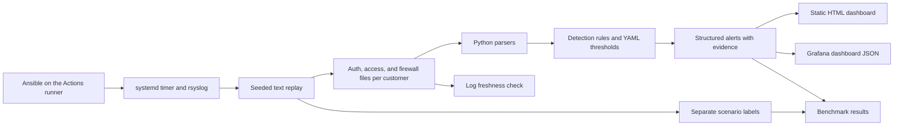

# SIEM Alerting Lab

This lab models a managed security team's workflow with fictional Linux auth, web access, and firewall logs. A seeded replay provides normal activity, a quiet admin with a few failed logins, and incident patterns for SSH brute force, password spraying, impossible travel, web scanning, and unusual outbound volume. The generator writes text files and does not send network traffic.

## Run the demo

From a checkout with Python 3.11 and Bash, run these three commands.

```bash
python3.11 -m venv .venv
.venv/bin/python -m pip install -r requirements.txt
.venv/bin/python -m siem_lab demo --out out
```

Open `out/dashboard.html` in a browser. It embeds matplotlib charts and reads as a standalone file. The same run writes the JSON alert evidence, benchmark results, and a Grafana dashboard JSON file under `out/`. The app uses no Docker, service accounts from external providers, or API keys.

## Architecture



The detectors share a parser and keep windows separated by customer and the rule's subject. The output preserves exact evidence lines, the crossing timestamp, severity, and a MITRE ATT&CK ID. The Sigma-style YAML describes the event selections. Thresholds and correlations live in Python and `config/rules.yml`.

## How this maps to SIEM operations

1. **Collect and validate.** Separate log feeds identify the customer. Rsyslog tails the fixture files, while the freshness check detects a missing, empty, or stale stream. The Bash check reports disk usage and the rsyslog service state.
2. **Detect and triage.** A rule groups events within a time window. An analyst can check the triggering records, decide whether the events fit the suspected behavior, and document a plausible benign explanation.
3. **Maintain detections.** The unit tests replay each reference scenario and the quiet admin. The alert health canary fails if a reference rule stops emitting. The benchmark also measures misses on borderline variants and compares them with benign controls.
4. **Report.** Dashboard counts show where alerts concentrated. The benchmark separates missed detections, benign alerts, and event-time latency so changing a threshold has visible consequences.

## Monitoring and provisioning

`python -m siem_lab.freshness --logs PATH --max-age-seconds SECONDS` checks event timestamps per customer and stream. With a fixed replay, pass `--now` at the replay end time. `bash scripts/check_host.sh MOUNT_PATH SYSTEMD_UNIT MAX_USED_PERCENT` checks a Linux host. Both return `0` for healthy, `1` for an alert, and `2` for invalid input or a failed probe.

The [Actions workflow](.github/workflows/ci.yml) runs Ruff, ShellCheck, ansible-lint, pytest with branch coverage, the full replay, and the dashboard capture. The separate provisioning job runs the Ansible playbook with `--connection=local --check`, applies it to its ephemeral Ubuntu runner, starts the service, and verifies the timer, rsyslog collection, freshness, and host checks. The playbook targets that CI runner. Proxmox and Azure are outside its verified scope.

## Scope

The logs, customer names, and location mappings are fictional. Activity thresholds and ATT&CK mappings are triage cues. Outbound volume alone cannot establish exfiltration and location changes can have legitimate causes. The Grafana file uses the [built-in TestData CSV Content format](https://grafana.com/docs/grafana/latest/datasources/testdata/) for a portable snapshot. No live Grafana server or SIEM product was used.

The repository owner has no experience with Splunk or Microsoft Sentinel.

OpenAI Codex wrote most of the code. Repository owner review is pending.
